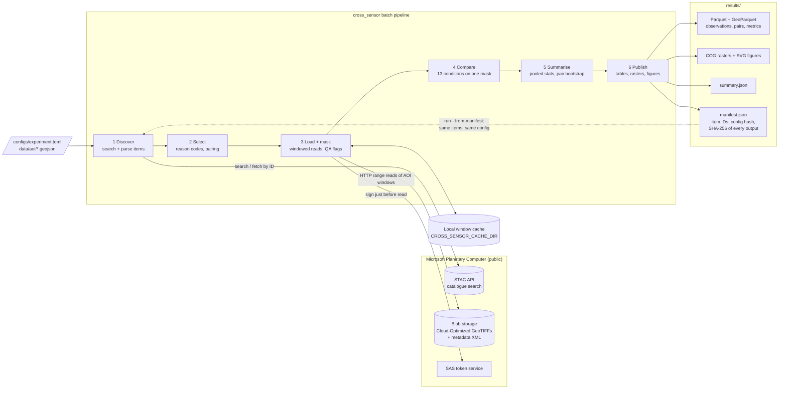
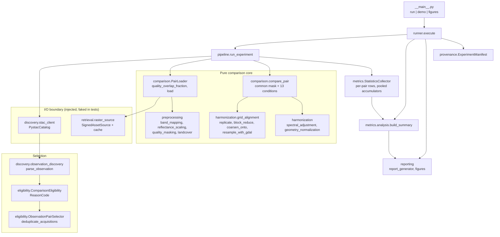
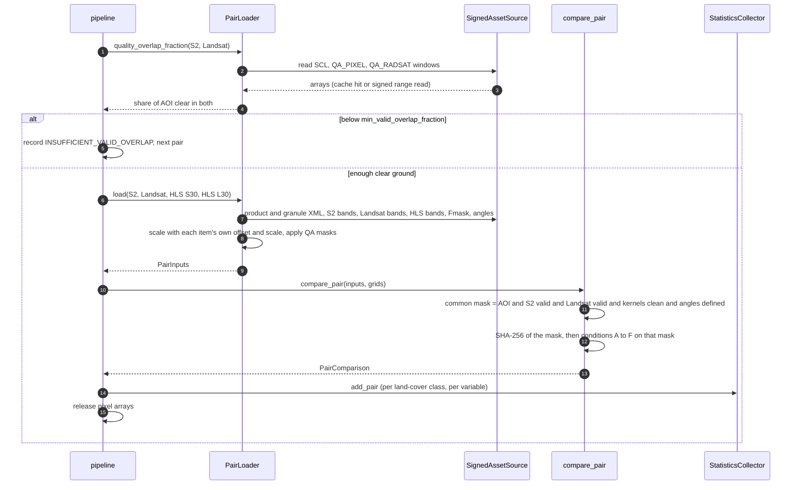
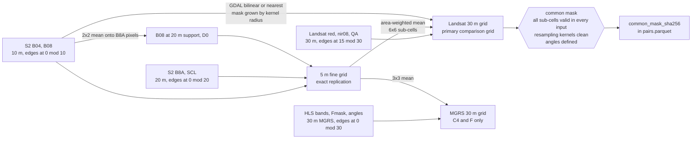

# cross-sensor-disagreement

Sentinel-2 and Landsat 8/9 observe the same ground and report different NDVI. This repo takes that difference apart one processing step at a time, over a 303 km² area of east Bengaluru. Each step is measured on the same pixels, so a change in disagreement comes from the step, not from a different sample.

## What it does

1. **Discover.** Searches Microsoft Planetary Computer's public STAC API for Sentinel-2 L2A, Landsat Collection 2 Level-2, HLS v2.0 and ESA WorldCover 2021 items over the AOI, 2023–2025.
2. **Select.** Gives every rejected item or pair an explicit reason code, then pairs each eligible Landsat scene with the nearest eligible Sentinel-2 scene within 72 hours.
3. **Mask.** Applies each product's own quality flags (SCL, QA_PIXEL, radiometric saturation) and keeps only 30 m cells that every condition can use.
4. **Compare.** Measures disagreement under the conditions below.

| Condition | What changes |
|---|---|
| A | Native pixels: S2 10 m vs Landsat 30 m, overlap-weighted |
| C1 | Common 30 m Landsat grid, S2 aggregated by exact area weighting |
| C2, C3 | As C1, but GDAL bilinear or nearest neighbour instead |
| C4 | HLS-style 30 m MGRS grid, Landsat cubic-resampled |
| D0 | C1 with B08 first averaged onto B8A's 20 m pixels (pixel-size change only) |
| D1 | D0 with B8A instead of B08 at the same 20 m pixels (band change only) |
| D2 | D1 + HLS v2.0 bandpass coefficients |
| E1 | D1 + c-factor view-angle normalization (HLS angle layers and BRDF parameters) |
| E2 | E1 + bandpass coefficients |
| F | The HLS v2.0 L30 and S30 products themselves |

## Architecture

### High-level design

One batch job reads open satellite data over HTTPS, makes every comparison on a shared set of valid cells, and writes results that can be traced back to the source images.



| Concern | How it is handled |
|---|---|
| Access | Anonymous public STAC. Asset URLs are signed per request, so short-lived tokens never expire mid-run. Tokens are stripped before anything is written. |
| Volume | Only the AOI window of each COG is read (HTTP range requests), about 0.7 GB (compressed, cached) for 47 pairs instead of full scenes. |
| Cost of reruns | Windows are cached on disk, keyed by the unsigned URL and bounds. A rerun reads no imagery. |
| Failure | Catalogue and raster reads retry with backoff. A pair that still fails is recorded with a reason code, and the run continues. |
| Reproducibility | The manifest pins every source item and the config hash. `--from-manifest` replays exactly those items. |

### Low-level design: components

Each package has one job. Input and output stay at the edges, and the comparison logic in the middle is pure array code, so it can be tested offline. `synthetic.py` swaps in a fake catalogue and raster source for the tests and the `demo` command.



### Low-level design: one observation pair

Every condition for a pair is computed from one set of inputs and one valid-cell mask. The pixel arrays are released as soon as the pair's statistics are recorded, so memory stays flat however many pairs there are.



### Low-level design: grids and the shared mask

The pipeline never resizes a raster just to make two arrays the same shape. All exact moves go through a 5 m lattice that every grid aligns to. If a raster is off that lattice, the pipeline raises an error instead of interpolating.



| Grid | Resolution and origin | Used by |
|---|---|---|
| Fine | 5 m, same extent as the Landsat grid | Native comparison (A), exact aggregation |
| Landsat | 30 m, pixel edges at 15 m mod 30 (USGS convention) | C1–C3, D0–D2, E0–E2 |
| MGRS | 30 m, pixel edges at 0 mod 30 (Sentinel-2 tiling) | C4 and HLS (F) |

### Design decisions

| Decision | Why | Rejected alternative |
|---|---|---|
| One shared mask per pair, with its SHA-256 recorded | A step can't "improve" just by dropping hard pixels | A separate mask per condition, which mixes effects with sample changes |
| Landsat's native grid as the primary grid | Landsat is never resampled, and Sentinel-2 aggregates to it exactly | The MGRS grid, which needs cubic resampling of Landsat (kept as C4) |
| Exact area weighting on a 5 m lattice | It's deterministic and checked against GDAL `average` to 0 DN | Generic resampling, whose kernel shape varies with the GDAL version |
| Coefficients only from published sources | Fitting on the same 47 pairs would make the result circular | Regression fitted per scene |
| Scale and offset read from each item's metadata | The Sentinel-2 offset depends on the processing baseline | Hard-coded constants |
| Bootstrap over pairs, not pixels | Pixels in one image share an atmosphere, so they aren't independent | Pixel bootstrap, which gives falsely narrow intervals |
| Signing at read time, unsigned URLs in all records | Tokens expire, and they must never be stored | Signing items once at search time |
| A reason code for every rejection | Nothing disappears from the sample silently | Filtering inside the search query |

## Results (actual run, 47 pairs)

NDVI disagreement, Sentinel-2 minus Landsat.
- Every step uses the same valid cells: 12,687,583 cell-observations, recorded per pair as a SHA-256 of the mask in `pairs.parquet`.
- Values are pooled over all cells (pixel-weighted). The per-pair distribution is in `summary.json`.
- Intervals are 95% bootstrap intervals that resample whole pairs. No scene appears in two pairs.

| Step | NDVI MAE | NDVI bias | NIR bias | Pearson r |
|---|---|---|---|---|
| A native pixels | 0.097 (0.093–0.102) | −0.036 | +0.022 | 0.859 |
| C1 common 30 m grid | 0.062 (0.058–0.066) | −0.041 | +0.022 | 0.955 |
| D0 B08 at 20 m support | 0.061 (0.057–0.066) | −0.040 | +0.022 | 0.955 |
| D1 B8A at 20 m support | 0.052 (0.048–0.055) | −0.022 | +0.034 | 0.958 |
| E1 + view-angle normalization | 0.051 (0.048–0.055) | −0.021 | +0.021 | 0.958 |
| E2 + bandpass adjustment | 0.048 (0.045–0.051) | −0.016 | +0.021 | 0.958 |

- **Spatial matching is the largest step:** −0.036 MAE. GDAL nearest neighbour (C3, 0.095) loses almost all of it. GDAL bilinear (C2, 0.058) slightly beats the exact area mean.
- **The NIR swap is spectral, not spatial:**
  - B08 → 20 m support changes MAE by −0.0004.
  - B08 → B8A at the same support changes it by −0.010 and halves the NDVI bias.
  - B8A's NIR reflectance is *further* from Landsat's (+0.034 vs +0.022). The NDVI gain partly comes from that brighter NIR offsetting Sentinel-2's brighter red.
- **View-angle normalization:** cuts the reflectance bias (red −0.0065, NIR −0.012) but barely moves NDVI. Every pair views the AOI from opposite sides at about 4.3°, so geometry hardly varies.
- **What remains after E2:**
  - Sentinel-2 is brighter by +0.017 in red and +0.021 in NIR.
  - On the cells both HLS products call clear, HLS shows reflectance biases under 0.005.
  - HLS changes several processing stages, so this does not isolate atmospheric correction.
- **Time between acquisitions:** no detectable trend.
  - Same-day pairs (n = 12, 14–15 min apart using tile sensing time) and 1–3-day pairs (n = 35) both have pooled MAE 0.062.
  - Spearman ρ is +0.21 (−0.11 to +0.49). The sample is small.
- **Land cover:**
  - Built-up bias improves from −0.061 to −0.034.
  - Tree cover bias worsens from +0.007 to +0.026.
  - Water stays near 0.14 MAE. Its NDVI denominator (red + NIR) is below 0.1 in 37–51% of water cells, against under 1% overall.
- **HLS aerosol flag:** marks a median of 93% (S30) and 88% (L30) of the AOI as high aerosol. It is recorded, not used as a mask.

Full numbers: `results/summary.json`. Per-pair metrics: `results/pair_metrics.parquet`.

## Run it

Python 3.13, with the packages pinned in `requirements.txt`. No account or API key is needed.

```bash
python -m venv .venv && .venv/Scripts/pip install -r requirements.txt   # bin/ on Linux and macOS
python -m unittest discover -s tests -t .           # 67 tests, offline
python -m cross_sensor demo --out demo-output       # offline end-to-end run on synthetic rasters
export CROSS_SENSOR_CACHE_DIR=.cache                # optional; reruns reuse downloaded windows
python -m cross_sensor run --out results            # full experiment, about 1-2 hours on first run
python -m cross_sensor run --from-manifest results/manifest.json --out rerun   # same items, same config
```

`results/manifest.json` records:
- the STAC endpoint, collections and every source item ID and asset path
- the configuration and AOI hashes, and the grid definitions
- the resampling methods and software versions
- a SHA-256 for every output

Temporary access signatures are stripped before anything is written.

## Data

- **Sentinel-2:** Copernicus Sentinel-2 L2A data.
- **Landsat:** courtesy of the U.S. Geological Survey.
- **HLS v2.0:** NASA LP DAAC.
- **WorldCover:** ESA WorldCover 2021 v200, CC-BY-4.0.

All four are accessed through Microsoft Planetary Computer. No imagery is redistributed here.

## Limitations

- **One AOI, mostly in the dry season.** Monsoon months yield almost no clear pairs.
- **Atmospheric correction is not separated out.** Sentinel-2 L2A uses Sen2Cor and Landsat L2 uses LaSRC. The remaining reflectance bias is consistent with that difference, but this design does not prove it.
- **Fixed geometry.** The view geometry barely varies between pairs, so its effect cannot be estimated from variation here.
- **Not the HLS method.** View-angle normalization uses the HLS c-factor parameters, but the prescribed solar zenith (the pair mean) differs from HLS's own model.
- **Land-cover dates.** WorldCover is from 2021, and the AOI has been developing since.

## Layout

| Path | Contents |
|---|---|
| `cross_sensor/discovery/` | STAC search, item parsing, Sentinel-2 metadata XML |
| `cross_sensor/retrieval/` | Signed, cached windowed reads |
| `cross_sensor/eligibility/` | Reason codes, pairing, de-duplication |
| `cross_sensor/preprocessing/` | Band mapping, reflectance scaling, quality masks, land cover |
| `cross_sensor/harmonization/` | Grids, exact aggregation, bandpass, c-factor BRDF |
| `cross_sensor/comparison/` | Per-pair conditions and NDVI |
| `cross_sensor/metrics/` | Residual statistics, pair bootstrap, summary |
| `cross_sensor/provenance/` | Manifest and hashing |
| `cross_sensor/reporting/` | Tables, COGs and figures |
| `configs/experiment.toml` | Every parameter of the run |
